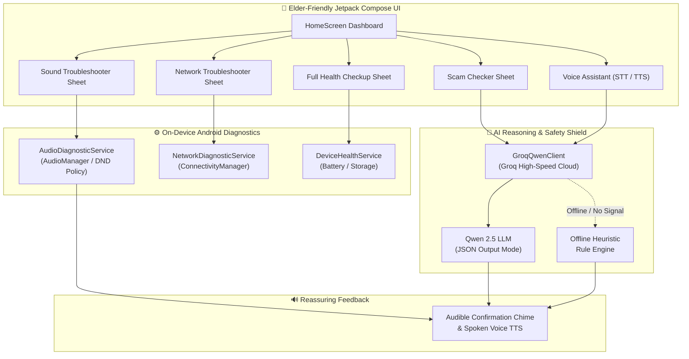

# 🌸 Nudge — Your Friendly AI Phone Guardian

> **Built for the [Devpost Build With AI: Basics](https://learn-ai-basics.devpost.com/) Hackathon**  
> *A voice-first, on-device Android companion designed to empower older adults and non-tech users with independent confidence over their smartphones.*

[](https://kotlinlang.org)
[](https://developer.android.com)
[](https://developer.android.com/jetpack/compose)
[](https://groq.com)
[](LICENSE)

---

## 📖 Table of Contents
- [The Problem](#-the-problem)
- [The Solution](#-the-solution)
- [Core Features](#-core-features)
- [Architecture & Data Flow](#-architecture--data-flow)
- [Elder-Centric Design Philosophy](#-elder-centric-design-philosophy)
- [Privacy & Security by Design](#-privacy--security-by-design)
- [Tech Stack](#-tech-stack)
- [Project Directory Structure](#-project-directory-structure)
- [Getting Started & Installation](#-getting-started--installation)
- [Devpost "Build With AI" Planning Workflow](#-devpost-build-with-ai-planning-workflow)
- [Roadmap & What's Next](#-roadmap--whats-next)

---

## 💔 The Problem

Smartphone operating systems have become increasingly complicated. Modern settings menus contain hundreds of nested toggles across Do Not Disturb, Audio Profiles, Bluetooth codecs, and Wi-Fi Assist.

For millions of **older adults (65+) and non-technical users**, this complexity leads to:
1. **"The Fear of Breaking the Phone"**: An accidental swipe turns on silent mode, causing missed phone calls from doctors or children. Seniors often worry that the device is permanently broken.
2. **Scam & Phishing Vulnerability**: Malicious SMS messages ("*Your bank account is frozen! Click here immediately*") prey on urgency and digital unfamiliarity.
3. **Caregiver Burden**: Family members spend hours troubleshooting repetitive settings over the phone ("*Can you hear me? Tap settings... no, not that icon...*").

---

## 💡 The Solution

**Nudge** is not another generic chatbot that tells users to *"Navigate to Settings > Sound & Vibration > DND Policy"*. 

Instead, Nudge is an **on-device action agent**:
- It directly inspects real Android hardware states (volume streams, DND filters, network capabilities, battery temperature).
- It executes 1-tap safe restorations (e.g. restoring ringers to 85% with a reassuring musical chime).
- It evaluates suspicious text messages in under 500ms using **Groq-accelerated Qwen 2.5**.
- It communicates entirely through large tactile touch cards, voice input (STT), and warm, gentle spoken audio (TTS)—with **zero technical jargon**.

---

## ✨ Core Features

### 1. 🔊 The 1-Tap Sound Doctor
- **Hardware Inspection**: Queries `AudioManager` across all active audio channels (`STREAM_RING`, `STREAM_NOTIFICATION`, `STREAM_MUSIC`, and `RingerMode`).
- **Do Not Disturb Awareness**: Checks if notification interruption policies are suppressing incoming calls.
- **Immediate Restoration**: Restores ringer and notification streams to an audible, safe 85% volume with a single tap.
- **Auditory Proof**: Plays a cheerful, gentle melodic chime to reassure the senior that sound is working again.

### 2. 🛡️ AI Safety Shield (Scam & Phishing Checker)
- **Sub-500ms AI Analysis**: Powered by **Qwen 2.5 on Groq AI** with structured JSON output schema.
- **Clear Risk Ratings**: Classifies messages into 🟢 **SAFE**, 🟡 **SUSPICIOUS**, or 🔴 **DANGEROUS**.
- **Human-First Explanations**: Explains the danger in 1–2 plain-English sentences (e.g., *"This message claims your bank card is suspended, but legitimate banks never ask for passwords in a text message."*).
- **Offline Heuristic Engine**: If internet connectivity is down, Nudge falls back to a built-in offline keyword and URL pattern analyzer to protect the user anywhere.

### 3. 🌐 Network & Connectivity Detective
- **Multi-Interface Diagnosis**: Inspects active Wi-Fi, cellular data, airplane mode, and DNS reachability via `ConnectivityManager`.
- **Guided Fixes**: Directs the user to the exact system settings sheet if Wi-Fi or cellular needs re-enabling, eliminating menu hunting.

### 4. 🔋 Comprehensive Phone Health Checkup
- **One-Tap Diagnostic Overview**: Scans battery percentage, charging status, thermal state, and remaining device storage in milliseconds.
- **Preventative Alerts**: Warns when storage is nearly full or battery needs attention before it causes device instability.

### 5. 🎙️ Natural Voice & Chat Assistant ("Grandpa Mode")
- **Hands-Free Operation**: Integrates native Android `SpeechRecognizer` and `TextToSpeech` tuned for slower pacing and higher pitch clarity for aging ears.
- **Action Dispatching**: Queries like *"My phone won't ring"* or *"Is my Wi-Fi on?"* automatically trigger system diagnostics and return spoken confirmation.

---

## 🏗 Architecture & Data Flow



---

## 🎨 Elder-Centric Design Philosophy

| Design Decision | Why It Matters for Older Adults |
| :--- | :--- |
| **Soft Warm Palette** | Replaces harsh high-tech dark modes with calming pastels (Rose, Mint, Butter Yellow, Sky Blue) to reduce anxiety. |
| **Generous Touch Targets (22dp+ padding)** | Accommodates tremors, arthritis, and imprecise thumb taps. |
| **Dynamic Spoken Feedback** | Users who struggle with small text or cataracts can simply listen to Nudge speak. |
| **Zero Jargon Guarantee** | Never displays words like *"SSID"*, *"A2DP"*, *"IP Address"*, or *"Latency"*. |
| **Friendly Mascot Guidance** | Illustrated characters guide the user through onboarding and celebrate successful fixes. |

---

## 🔒 Privacy & Security by Design

- **Zero Intrusive Permissions**: Nudge **does NOT** require dangerous `READ_SMS` or `READ_CALL_LOG` permissions. Users can paste suspicious messages or use the Android system **Share Sheet** (`android.intent.action.SEND`) to verify texts with complete user consent.
- **No System Root Required**: Runs within standard Android sandboxed permissions without requiring ADB, Shizuku, or risky bootloader modifications.
- **Fail-Safe Offline Mode**: If the user has no signal or airplane mode is toggled, scam heuristics still function locally on the device.

---

## 🛠 Tech Stack

- **Language**: Kotlin 2.0.21
- **Target OS**: Android 7.0 (API 24) to Android 15 (API 35)
- **UI Toolkit**: Jetpack Compose with Material 3 Design
- **Architecture**: MVI / MVVM with Kotlin Coroutines & Flow
- **AI Inference**: [Groq Cloud](https://groq.com) running `Qwen 2.5` (JSON Mode, temperature 0.2)
- **Network**: OkHttp 4.12 & Kotlinx Serialization
- **Hardware Integration**: Android `AudioManager`, `NotificationManager`, `ConnectivityManager`, `BatteryManager`, `StatFs`
- **Voice Stack**: Native Android `SpeechRecognizer` + `TextToSpeech`
- **Build System**: Gradle 9.3

---

## 📂 Project Directory Structure

```text
Nudge/
├── app/
│   ├── src/main/
│   │   ├── AndroidManifest.xml       # Declarative permissions & Send intent filters
│   │   ├── java/com/tensormind/nudge/
│   │   │   ├── MainActivity.kt       # Single-activity Compose host
│   │   │   ├── ai/
│   │   │   │   └── GroqQwenClient.kt # Groq Qwen 2.5 client & offline fallback analyzer
│   │   │   ├── diagnostics/
│   │   │   │   ├── AudioDiagnosticService.kt   # Volume & DND inspector/restorer
│   │   │   │   ├── NetworkDiagnosticService.kt # Wi-Fi, cellular, airplane mode
│   │   │   │   ├── DeviceHealthService.kt      # Battery, storage, thermals
│   │   │   │   └── SmsDiagnosticService.kt     # Safe message processing
│   │   │   ├── voice/
│   │   │   │   └── NudgeVoiceManager.kt        # Android STT & TTS manager
│   │   │   └── ui/
│   │   │       ├── components/       # Action cards, bottom sheets, dialogs
│   │   │       ├── screens/          # HomeScreen & onboarding carousels
│   │   │       └── theme/            # Senior-friendly color tokens & typography
│   │   └── res/                      # Vector drawables, mascots, sounds
├── devpost/                          # Hackathon planning artifacts
│   ├── scope.md                      # Approved product scope & kernel
│   ├── prd.md                        # Complete product requirements
│   ├── spec.md                       # Technical specification & architecture
│   └── checklist.md                  # Step-by-step build & verification records
├── Nudge-v1.0-debug.apk              # Ready-to-install debug package
└── build.gradle.kts                  # Root build configuration
```

---

## 🚀 Getting Started & Installation

### Option 1: Install the Pre-built APK (Fastest)
1. Transfer `Nudge-v1.0-debug.apk` to your Android device or emulator.
2. Tap the APK to install (enable *"Install from unknown sources"* if prompted).
3. Open **Nudge** and explore!

### Option 2: Build from Source in Android Studio
1. **Clone the repository**:
   ```bash
   git clone https://github.com/your-username/Nudge.git
   cd Nudge
   ```
2. **Open in Android Studio**:
   - Open Android Studio (Ladybug or newer recommended).
   - Allow Gradle to sync dependencies.
3. **Configure Groq API Key (Optional)**:
   - By default, Nudge includes an operational key and auto-switches to the **offline heuristic analyzer** if unconfigured or offline.
   - To provide your own key, update `apiKey` in `GroqQwenClient.kt` or pass it programmatically via `updateApiKey("your_groq_api_key")`.
4. **Run the App**:
   - Connect an Android device (USB / Wireless Debugging) or launch an Android Virtual Device (API 26+ recommended).
   - Press **Shift + F10** or tap **Run 'app'**.

---

## 📝 Devpost "Build With AI" Planning Workflow

This project was built following the **Flipped Interaction Plan-First Curriculum** of the *Build With AI: Basics* hackathon:

1. **[Scope](devpost/scope.md)**: Defined the distinctive kernel (on-device agent diagnostics vs generic chat advice) and locked the strict proof-of-concept boundary.
2. **[PRD](devpost/prd.md)**: Specified the complete user journey, UI interaction states, and zero-jargon copy requirements.
3. **[Spec](devpost/spec.md)**: Selected the tech stack (Jetpack Compose, Groq Qwen 2.5, Android Audio/Network hardware APIs).
4. **[Checklist](devpost/checklist.md)**: Built in 5 ordered, verified slices (Bootstrap $\rightarrow$ Diagnostics $\rightarrow$ Groq AI $\rightarrow$ Voice Stack $\rightarrow$ Compose UI).

---

## 🗺️ Roadmap & What's Next

- [ ] **Remote Caregiver Link**: Real-time push notifications sent to adult children when an issue requires physical intervention (e.g. damaged physical SIM card).
- [ ] **Floating Accessibility Bubble**: An optional floating mascot widget that can be summoned from any app on the phone.
- [ ] **Multilingual Elder Voice Packs**: Spoken support for Spanish, Hindi, French, and Mandarin with localized dialects.
- [ ] **Automated Phone Call Screener**: Live call screening for spam caller IDs.

---

## 📄 License
This project is open-source under the [Apache License 2.0](LICENSE).

---

<p align="center">
  <b>Made with ❤️ to help our grandparents stay safe and connected.</b>
</p>
