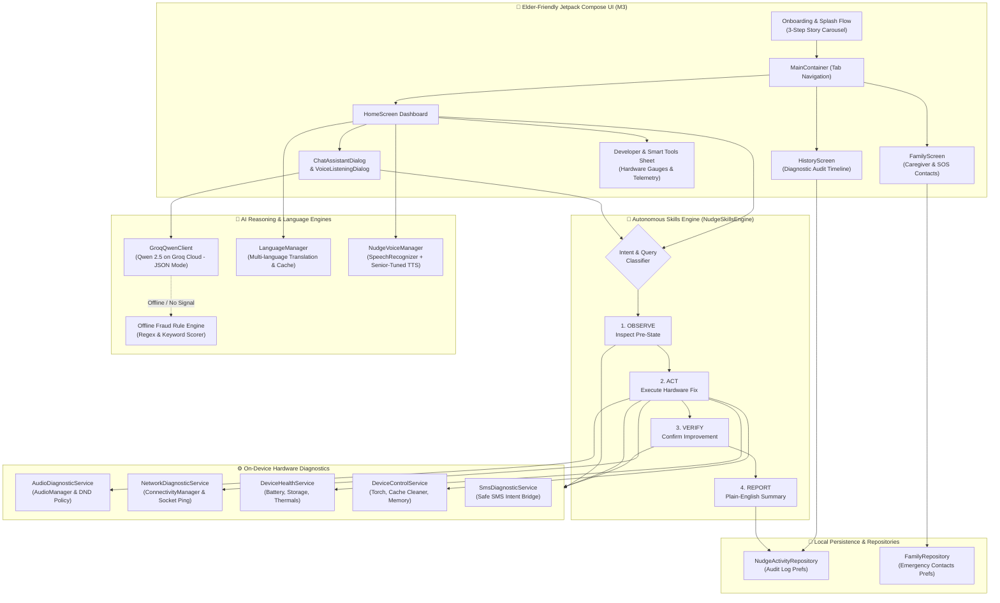
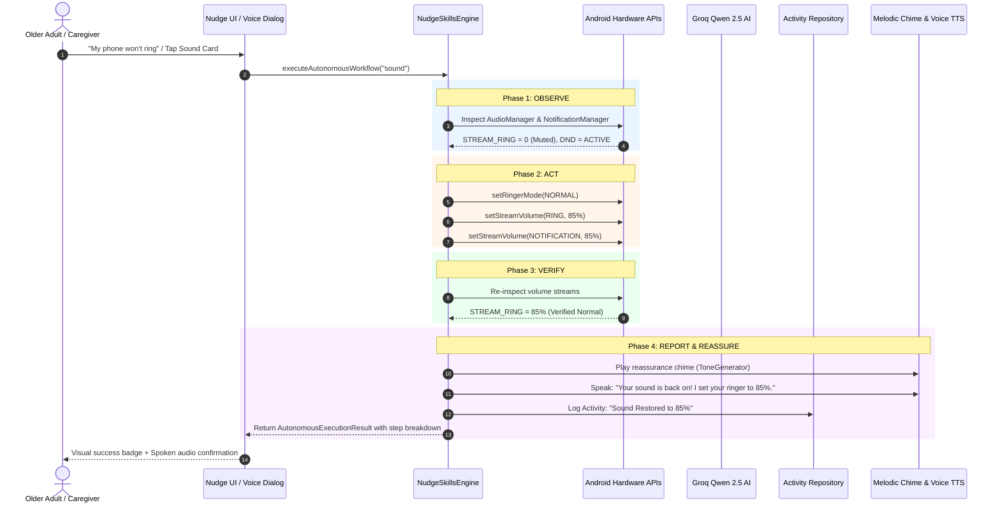

# 🌸 Nudge — Your Friendly AI Phone Guardian

> **Built for the [Devpost Build With AI: Basics](https://learn-ai-basics.devpost.com/) Hackathon**  
> *A voice-first, on-device Android companion designed to empower older adults and non-tech users with independent confidence over their smartphones.*

[](https://kotlinlang.org)
[](https://developer.android.com)
[](https://developer.android.com/jetpack/compose)
[](https://groq.com)
[](https://gradle.org)
[](LICENSE)

---

## 📖 Table of Contents
1. [The Problem](#-the-problem)
2. [The Solution: Action Agent vs. Advice Chatbot](#-the-solution-action-agent-vs-advice-chatbot)
3. [Key Features & Capabilities](#-key-features--capabilities)
   - [1. 🔊 The 1-Tap Sound Doctor](#1--the-1-tap-sound-doctor)
   - [2. 🛡️ AI Safety Shield (Scam & Phishing Checker)](#2-️-ai-safety-shield-scam--phishing-checker)
   - [3. 🧠 Autonomous Multi-Step Skills Engine](#3--autonomous-multi-step-skills-engine)
   - [4. 🌐 Network & Connectivity Detective](#4--network--connectivity-detective)
   - [5. 🔋 Device Health & Storage Checkup](#5--device-health--storage-checkup)
   - [6. 🎙️ Dual Voice & Chat Modalities ("Grandpa Mode")](#6-️-dual-voice--chat-modalities-grandpa-mode)
   - [7. 👨‍👩‍👧 Family & Caregiver Connect](#7--family--caregiver-connect)
   - [8. 📋 Activity Audit & Diagnostic History](#8--activity-audit--diagnostic-history)
   - [9. 🌍 Multilingual Translation Engine](#9--multilingual-translation-engine)
   - [10. ⚡ Bright-Mode Smart Tools Panel](#10--bright-mode-smart-tools-panel)
4. [Elder-Centric Design Philosophy](#-elder-centric-design-philosophy)
5. [System Architecture & Data Flow](#-system-architecture--data-flow)
6. [Autonomous Skills Engine Loop](#-autonomous-skills-engine-loop)
7. [Privacy & Security by Design](#-privacy--security-by-design)
8. [Tech Stack](#-tech-stack)
9. [Project Directory Structure](#-project-directory-structure)
10. [Getting Started & Installation](#-getting-started--installation)
11. [Devpost "Build With AI" Planning Workflow](#-devpost-build-with-ai-planning-workflow)
12. [Roadmap & Future Enhancements](#-roadmap--future-enhancements)
13. [License & Acknowledgments](#-license--acknowledgments)

---

## 💔 The Problem

Modern smartphone operating systems have grown overwhelmingly complex. A standard Android device contains over 300 nested settings menus spanning Do Not Disturb profiles, volume attenuation channels, Bluetooth audio routing, cellular data toggles, and notification priority filters.

For **millions of older adults (65+) and non-technical individuals**, this complexity creates severe everyday friction:

1. **"The Fear of Breaking the Phone"**: An accidental swipe or accidental button press mutes the ringer or turns on Do Not Disturb. Seniors miss critical calls from doctors, pharmacies, and grandchildren—often believing their phone is permanently broken.
2. **Scam & Phishing Vulnerability**: Malicious SMS messages (*"Your bank account has been frozen! Click here immediately to verify your identity"*) prey on fear, urgency, and unfamiliarity with digital deception.
3. **Caregiver Burden**: Family members spend hours every week trying to troubleshoot basic settings over remote phone calls (*"Can you hear me? Tap Settings... No, not the gear on the home screen, the one in the swipe down tray..."*).
4. **Cognitive Overload**: When seniors search online or ask modern AI chatbots, they receive 10-step technical instructions filled with jargon like *SSID*, *A2DP*, *IP configuration*, and *cache partition*.

---

## 💡 The Solution: Action Agent vs. Advice Chatbot

**Nudge is fundamentally different.** It does not tell the senior how to navigate a maze of menus.

Instead, Nudge is an **on-device action agent**:
- **Direct System Inspection**: It reads real Android hardware states (volume channels, DND policy, network capabilities, battery temperature, storage).
- **1-Tap Autonomous Remediation**: It repairs issues directly with a single tap (e.g. restoring ringers to 85% with an immediate auditory confirmation chime).
- **Sub-500ms AI Threat Intelligence**: Powered by **Groq-accelerated Qwen 2.5**, it evaluates suspicious messages and provides plain-English verdicts.
- **Warm, Tactile Interface**: Uses oversized touch targets (22dp+ padding), calming pastels, voice input (STT), and gentle spoken audio (TTS)—with **zero technical jargon**.

```text
❌ TRADITIONAL AI CHATBOT:
"To fix your sound, open Settings, scroll to Sound & Vibration, select Do Not Disturb,
ensure your ringer volume stream is above 50%, and check if DND Schedule is overriding media."
-> (Overwhelms the senior, leads to abandonment)

✅ NUDGE PHONE GUARDIAN:
"I checked your phone! Your ringer was accidentally turned off. 
I turned it back on to 85% and played a chime so you know it works."
-> (Instant relief and restored confidence)
```

---

## ✨ Key Features & Capabilities

### 1. 🔊 The 1-Tap Sound Doctor
- **Comprehensive Hardware Inspection**: Evaluates all primary audio channels via `AudioManager` (`STREAM_RING`, `STREAM_NOTIFICATION`, `STREAM_MUSIC`, `STREAM_SYSTEM`, and `RingerMode`).
- **Do Not Disturb Policy Awareness**: Inspects `NotificationManager.getCurrentInterruptionFilter()` to detect if silent interruption policies are blocking incoming phone calls.
- **1-Tap Safe Restoration**: Re-enables ringer mode to `RINGER_MODE_NORMAL` and restores streams to a safe, comfortable 85% volume level.
- **Audible Proof of Fix**: Plays a cheerful melodic confirmation chime (`ToneGenerator`) so the user immediately knows their speaker works.
- **Spoken Reassurance**: Accompanied by soothing voice feedback affirming the phone is ready for calls.

### 2. 🛡️ AI Safety Shield (Scam & Phishing Checker)
- **Sub-500ms Inference**: Powered by **Groq Cloud** running `Qwen 2.5` with strict JSON schema constraints and low temperature (0.2).
- **Three-Tier Safety Classification**:
  - 🟢 **SAFE**: Legitimate message with zero malicious flags.
  - 🟡 **SUSPICIOUS**: Unverified urgency or unexpected sender; proceed with caution.
  - 🔴 **DANGEROUS**: High-risk phishing, fraud, credential harvesting, or fake bank alert.
- **Zero-Jargon Explanations**: 1–2 plain-English sentences explaining the risk (e.g., *"This message claims your bank card is suspended, but legitimate banks never ask for passwords in a text message."*).
- **Android System Share Sheet Integration**: Users don't need to copy-paste. From any messaging app (SMS, WhatsApp), users tap **Share** $\rightarrow$ **Nudge** to instantly evaluate the text.
- **Offline Heuristic Rule Engine**: If the device has no internet connection, Nudge automatically falls back to an internal pattern matcher with regex link verification and fraud keyword detection.

### 3. 🧠 Autonomous Multi-Step Skills Engine
Nudge features an autonomous execution pipeline (`NudgeSkillsEngine.kt`) that follows a 4-phase loop:
$$\text{Observe} \longrightarrow \text{Act} \longrightarrow \text{Verify} \longrightarrow \text{Report}$$

Available autonomous workflows:
- ⚡ **Performance Booster**: Measures system RAM before and after, invokes GC, cleans app caches, and reports reclaimed memory.
- 🔊 **Audio Repair**: Detects muted ringer, overrides suppression, tests speaker with melodious tone.
- 🌐 **Network Doctor**: Tests Wi-Fi and mobile data interfaces, performs low-level socket ping latency test, and provides guided deep-links.
- 🔦 **Flashlight / Torch**: Instantly activates or deactivates the device torch via `CameraManager`.
- 🔋 **Battery & Storage Triage**: Detects thermal throttling, charging state, and storage bottlenecks.
- 🛡️ **Scam Triage**: Rapid evaluation of suspicious messages.
- 🩺 **Comprehensive Self-Healing**: Full multi-point device triage with an end-to-end audit report.

### 4. 🌐 Network & Connectivity Detective
- **Multi-Interface Diagnosis**: Inspects active Wi-Fi, mobile cellular data, and Airplane Mode via `ConnectivityManager`.
- **Live Internet Reachability**: Verifies true DNS and IP connectivity using low-latency socket checks to avoid captive portal traps.
- **Guided Fixes**: Directs the senior straight to the exact system settings sheet if Wi-Fi or cellular needs re-enabling, eliminating menu hunting.

### 5. 🔋 Device Health & Storage Checkup
- **One-Tap Diagnostic Overview**: Scans battery percentage, charging status, battery temperature, and remaining storage in milliseconds.
- **Preventative Alerts**: Warns when storage is under 2GB or battery thermals exceed safe thresholds before instability occurs.

### 6. 🎙️ Dual Voice & Chat Modalities ("Grandpa Mode")
- **Voice-First Modal (`VoiceListeningDialog.kt`)**: Native Android `SpeechRecognizer` with animated breathing audio ripples. Tuned with speech punctuation heuristics.
- **Conversational Chat Assistant (`ChatAssistantDialog.kt`)**: Interactive chat interface for users who prefer typing, with preset quick-tap prompts and autonomous skill execution.
- **Elder-Tuned TTS (`TextToSpeech`)**: Speech rate calibrated to 0.85x and pitch tuned for optimal clarity with aging auditory perception.

### 7. 👨‍👩‍👧 Family & Caregiver Connect
- **Dedicated Family Screen (`FamilyScreen.kt`)**: Pin primary family contacts (daughter, son, caregiver) with names and relationship tags.
- **1-Tap Direct Actions**: Call instantly (`Intent.ACTION_DIAL`) or compose SMS (`Intent.ACTION_SENDTO`) without navigating complex address books.
- **Emergency SOS Alert**: One-tap trigger to send emergency pre-filled messages with battery and diagnostic status.
- **Caregiver Auto-Alerts Toggle**: Enable or disable automated alerts for critical device issues.

### 8. 📋 Activity Audit & Diagnostic History
- **Persistent Activity Timeline (`HistoryScreen.kt`)**: Keeps a chronological log of all sound repairs, scam scans, health checkups, and performance boosts.
- **Color-Coded Status Badges**: Quick visual categorization (Sound Fixed, Scam Blocked, Health Scan, Memory Freed).
- **Offline Storage**: Persisted locally in encrypted SharedPreferences in JSON format; privacy-preserving and inspectable anytime.

### 9. 🌍 Multilingual Translation Engine
- **Built-in `LanguageManager.kt`**: Supports 5 languages:
  - 🇺🇸 **English** (with full voice TTS support)
  - 🇪🇸 **Español**
  - 🇮🇳 **हिन्दी**
  - 🇫🇷 **Français**
  - 🇩🇪 **Deutsch**
- **Dynamic Translation**: Integrates resilient translation endpoints with in-memory caching for zero-latency screen transitions.
- **Safety Fallback**: Gracefully falls back to English TTS so voice output is always intelligible.

### 10. ⚡ Bright-Mode Smart Tools Panel
- **Caregiver & Developer Sheet (`DeveloperDiagnosticsSheet.kt`)**:
  - Live hardware gauges (Battery %, Free Storage, Wi-Fi / Cell status, Ringer state).
  - Groq AI telemetry metrics (last query latency in ms, token usage).
  - Quick action controls: Torch toggle, Audio test chime, Memory cache clear.
  - Groq API Key configuration with in-app storage.

---

## 🎨 Elder-Centric Design Philosophy

| Design Pillar | Implementation in Nudge | Why It Matters for Older Adults |
| :--- | :--- | :--- |
| **Calming Pastels** | Soft Rose (`#FFF0F2`), Mint (`#E8F8F0`), Butter Yellow (`#FFFBEB`), Sky Blue (`#EBF5FF`) | Replaces cold, high-tech dark modes with inviting colors that reduce technology anxiety. |
| **Generous Touch Targets** | Minimum 64dp button heights and 22dp+ card padding | Accommodates finger tremors, arthritis, and imprecise thumb taps. |
| **Audio-Visual Redundancy** | Every action pairs large text with spoken voice (TTS) and melodic chimes | Supports users with cataracts, vision impairment, or reading difficulties. |
| **Zero Jargon Rule** | "Your ringer was quiet" instead of "Audio stream attenuated" | Eliminates confusing technical vocabulary and acronyms. |
| **Playful Mascot Companion** | Animated breathing companion ("Nudge the Puppy") | Creates emotional safety and warmth; celebrates successful fixes. |

---

## 🏗 System Architecture & Data Flow



---

## 🔄 Autonomous Skills Engine Loop

Nudge implements an agentic self-healing architecture:



---

## 🔒 Privacy & Security by Design

Nudge was engineered from day one to operate securely within standard Android platform boundaries:

- **Zero Sensitive Permissions**: Nudge **DOES NOT** request `READ_SMS`, `READ_CALL_LOG`, or `ACCESS_FINE_LOCATION`.
- **System Share Sheet Integration**: Rather than reading the user's private inbox in the background, Nudge relies on user-initiated Android **Share Sheet** (`Intent.ACTION_SEND`). The user chooses exactly which text to verify.
- **No System Root or Dangerous Exploits**: Does not require root access, ADB pairing, or Shizuku modifications. Runs safely inside standard Android sandboxing.
- **Private On-Device Data**: Activity logs and family contacts are stored entirely in private, sandboxed app storage. No analytics tracking or behavioral profiling.
- **Fail-Safe Offline Mode**: If internet access is lost, Nudge automatically routes scam analyses to its built-in offline regex rule engine, ensuring senior protection even without a cellular data plan.

---

## 🛠 Tech Stack

| Layer | Technologies & Libraries |
| :--- | :--- |
| **Language** | Kotlin 2.0.21 |
| **Target Platforms** | Android 7.0 (API 24) to Android 15 (API 35) |
| **UI Framework** | Jetpack Compose (1.7+) with Material Design 3 |
| **Architecture** | MVI / MVVM with Kotlin Coroutines (`Dispatchers.IO`, `Dispatchers.Main`) & StateFlow |
| **Cloud AI Model** | [Groq Cloud](https://groq.com) inference running `Qwen 2.5` (JSON Mode, temperature 0.2) |
| **Networking** | OkHttp 4.12.0 & Kotlinx Serialization JSON |
| **Hardware APIs** | Android `AudioManager`, `NotificationManager`, `ConnectivityManager`, `BatteryManager`, `CameraManager`, `StatFs`, `ActivityManager` |
| **Voice Stack** | Native Android `SpeechRecognizer` + `TextToSpeech` (with pitch/rate tuning) |
| **Audio Feedback** | `ToneGenerator` (2-tone melodic harmonic chime) |
| **Build Tooling** | Gradle 9.3 |

---

## 📂 Project Directory Structure

```text
Nudge/
├── app/
│   ├── src/main/
│   │   ├── AndroidManifest.xml              # Declarative permissions & ACTION_SEND intent filters
│   │   ├── java/com/tensormind/nudge/
│   │   │   ├── MainActivity.kt              # Main entry point & Intent handler
│   │   │   ├── ai/
│   │   │   │   ├── GroqQwenClient.kt        # Groq Qwen 2.5 client & offline fraud analyzer
│   │   │   │   ├── LanguageManager.kt       # Multi-language translation & in-memory cache
│   │   │   │   └── NudgeSkillsEngine.kt     # Autonomous Observe-Act-Verify-Report engine
│   │   │   ├── diagnostics/
│   │   │   │   ├── AudioDiagnosticService.kt   # AudioManager & DND policy inspector/restorer
│   │   │   │   ├── DeviceControlService.kt     # Torch, memory cleanup, and device controls
│   │   │   │   ├── DeviceHealthService.kt      # Battery, storage, and thermal metrics
│   │   │   │   ├── NetworkDiagnosticService.kt # Connectivity, Wi-Fi, cell & socket pings
│   │   │   │   ├── NudgeDataRepositories.kt    # Persistent Activity and Family repositories
│   │   │   │   └── SmsDiagnosticService.kt     # Safe SMS text bridge and pre-processing
│   │   │   ├── voice/
│   │   │   │   └── NudgeVoiceManager.kt        # Android SpeechRecognizer & TextToSpeech manager
│   │   │   └── ui/
│   │   │       ├── components/
│   │   │       │   ├── ChatAssistantDialog.kt        # Conversational plain-English assistant
│   │   │       │   ├── DeveloperDiagnosticsSheet.kt  # Bright Mode Smart Tools & hardware panel
│   │   │       │   ├── FeatureCard.kt                # Primary interactive card component
│   │   │       │   ├── FullCheckupCard.kt            # Diagnostic overview banner card
│   │   │       │   ├── FullCheckupSheet.kt           # Full system health breakdown modal
│   │   │       │   ├── NetworkTroubleshooterSheet.kt # Guided network resolution modal
│   │   │       │   ├── NudgeBottomNavigation.kt      # Senior-friendly bottom navigation bar
│   │   │       │   ├── PageIndicator.kt              # Animated carousel dot indicator
│   │   │       │   ├── QuickActionCard.kt            # High-visibility quick diagnostic cards
│   │   │       │   ├── ScamCheckerSheet.kt           # AI SMS & phishing analyzer modal
│   │   │       │   ├── SoundTroubleshooterSheet.kt   # Sound Doctor & audio restoration modal
│   │   │       │   ├── SpeechBubble.kt               # Conversational speech bubble layout
│   │   │       │   └── VoiceListeningDialog.kt       # Voice recognition modal with audio ripples
│   │   │       ├── screens/
│   │   │       │   ├── FamilyScreen.kt               # Caregiver contacts, 1-tap call/SMS & SOS
│   │   │       │   ├── HistoryScreen.kt              # Persistent audit log & resolution timeline
│   │   │       │   ├── HomeScreen.kt                 # Main dashboard with mascot & quick cards
│   │   │       │   ├── MainContainer.kt              # Tab coordinator with crossfade animations
│   │   │       │   ├── OnboardingContainer.kt        # 3-step introductory story coordinator
│   │   │       │   ├── SplashScreen1.kt              # Story card 1: Phone troubles
│   │   │       │   ├── SplashScreen2.kt              # Story card 2: 1-tap fixes
│   │   │       │   └── SplashScreen3.kt              # Story card 3: Family connect & setup
│   │   │       └── theme/                            # Elder-friendly pastel palette & typography
│   │   └── res/                                      # Mascot vectors, icons, and drawables
│   └── build.gradle.kts                              # App-level dependencies & build rules
├── devpost/                                          # Hackathon curriculum & planning artifacts
│   ├── scope.md                                      # Project kernel & boundary definition
│   ├── prd.md                                        # Product requirements document
│   ├── spec.md                                       # Technical specification & architecture
│   └── checklist.md                                  # Step-by-step build & verification records
├── build.gradle.kts                                  # Root build configuration
└── settings.gradle.kts                               # Project module settings
```

---

## 🚀 Getting Started & Installation

### Build & Run from Source (Android Studio)
1. **Clone the Repository**:
   ```bash
   git clone https://github.com/Baklolman69/Nudge.git
   cd Nudge
   ```

2. **Open in Android Studio**:
   - Launch **Android Studio** (Ladybug 2024.2.1 or newer recommended).
   - Select **Open an Existing Project** and choose the `Nudge` folder.
   - Allow Gradle to sync and download dependencies.

3. **Configure Groq API Key (Optional)**:
   - Nudge includes an operational default key and automatically switches to the **offline heuristic rule engine** if unconfigured or offline.
   - You can enter your own Groq key directly in the app via **⚡ Tools** (top right on Home screen) $\rightarrow$ **Smart Assistant Tools** $\rightarrow$ **Groq API Key**.
   - Or configure it programmatically in `GroqQwenClient.kt`.

4. **Run on Device or Emulator**:
   - Connect an Android device (via USB or Wireless Debugging) or launch an Android Virtual Device (AVD running API 26 or higher).
   - Click the green **Run 'app'** button or press **Shift + F10**.
   - Alternatively, build from command line:
     ```bash
     ./gradlew assembleDebug
     ```

---

## 📝 Devpost "Build With AI" Planning Workflow

This project was built following the **Flipped Interaction Plan-First Curriculum** of the *Build With AI: Basics* hackathon:

- 🎯 **[Scope Doc](devpost/scope.md)**: Defined the distinctive kernel (on-device action agent vs. generic chatbot) and locked the strict proof-of-concept boundary.
- 📋 **[PRD](devpost/prd.md)**: Specified the complete user journey, UI interaction states, and zero-jargon copy requirements.
- 📐 **[Spec](devpost/spec.md)**: Architected the tech stack, component interactions, and data models.
- ✅ **[Build Checklist](devpost/checklist.md)**: Executed across 5 verified, incremental slices:
  1. *Project Bootstrap & System Dependencies*
  2. *Real Android Diagnostic Engines*
  3. *Groq Qwen 2.5 AI & Scam Risk Analyzer*
  4. *Open-Source Voice Stack (STT + TTS)*
  5. *Interactive UI Modals & Home Dashboard Integration*

---

## 🗺️ Roadmap & Future Enhancements

- [ ] **Cloud Caregiver Sync (Firebase)**: Push notifications to family members when an issue requires physical intervention (e.g. damaged physical SIM card).
- [ ] **Floating Accessibility Bubble**: An optional floating mascot widget that can be summoned from any screen or app.
- [ ] **Multilingual Neural TTS**: High-fidelity localized speech models for Spanish, Hindi, French, and German.
- [ ] **Live Call Screener**: Real-time screening of incoming calls against known spam databases.

---

## 📄 License & Acknowledgments

Distributed under the **Apache License 2.0**. See `LICENSE` for details.

### Special Thanks
- **Devpost & Google**: For organizing the *Build With AI: Basics* learning hackathon.
- **Groq & Qwen Teams**: For the ultra-fast LPU inference platform and Qwen 2.5 model.

---

<p align="center">
  <b>Made with ❤️ to help our grandparents stay safe, confident, and connected.</b>
</p>
